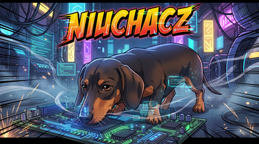
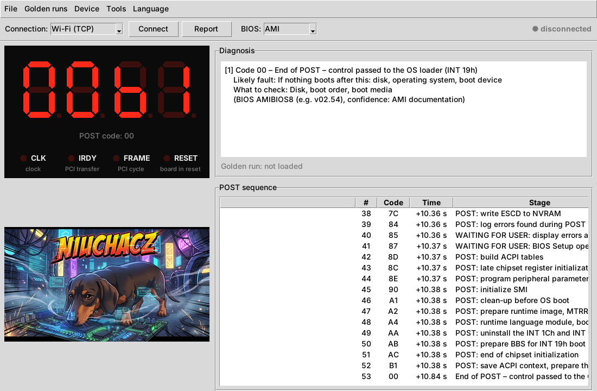

<p align="center">
  
</p>

<h1 align="center">NIUCHACZ</h1>

<p align="center">
  <b>POST code logger for vintage PCs: ESP32 + a cheap PCI/ISA POST card + a desktop app</b><br>
  <i>Rejestrator kodów POST dla starych komputerów: ESP32 + tania karta POST PCI/ISA + aplikacja na PC</i>
</p>

<p align="center">
  🚧 <b>Work in progress / Prace trwają</b> – it works, it is not finished. / Działa, ale nie jest skończone.
</p>

**[English](#english) · [Polski](#polski)**

<p align="center">
  <br>
  <sub>Replay of a real POST run (ASRock 775V88, AMIBIOS8): 53 codes in 11 seconds. /
  Odtworzenie prawdziwego przebiegu POST: 53 kody w 11 sekund.</sub>
</p>

---

## English

### What is it?

A POST card shows the last code the BIOS wrote to I/O port `80h`. That is all it shows. Everything
that happened before flashes by faster than you can read, and many codes last less than a millisecond.

**NIUCHACZ** taps a standard, cheap "PC Analyzer" PCI/ISA POST card and sends **every** code to a PC
over Wi-Fi or USB. The desktop app:

- records the whole boot sequence with timestamps,
- describes each code (AMIBIOS8 from AMI's official checkpoint list, Award and Phoenix in progress),
- recognises a stall, a "waiting for the user" state (F1, BIOS Setup) and the end of POST,
- splits sessions automatically when the board reboots,
- compares a run with a known-good "golden" run of the same board,
- produces a plain-text report (72 columns, prints on A4) for the repair ticket.

Example: [full report of a real run](docs/sample_report_asrock_775v88.txt).

### How it works

The first version read the card's 7-segment display. Multiplexing, analog levels and segment mapping
made that slow and fragile, and the display is slower than the BIOS anyway.

The current version reads the **output pins of the 74LCX374 chip** on the card. The card stores the byte
written to port `80h` in this chip, and its output pins (Q0–Q7) carry plain, static logic levels. Eight wires and ground, no
calibration. Every change of the byte is a new POST code; an ESP32 polls the lines at ~1.4 MHz and catches
codes the card's own display never shows.

```
PC Analyzer card ── 74LCX374 Q0–Q7 + GND ── ribbon / DB25 ──► NIUCHACZ box
                                                              CD4050 (5 V → 3.3 V)
                                                              ESP32 (MicroPython)
                                                                 │ Wi-Fi AP / USB serial (JSON lines)
                                                                 ▼
                                                              Desktop app (Python, tkinter)
```

### Hardware (prototype)

| Part | Notes |
|---|---|
| POST card "PC Analyzer" PCI/ISA, 4 digits | SyncMOS SM2965, GAL16V8D, **74LCX374** |
| ESP32-WROOM-32U + screw-terminal adapter | external 2.4 GHz antenna (U.FL) |
| 3 × CD4050 | level shift 5 V → 3.3 V, 100 kΩ pull-down on every input |
| DB25 connector + ribbon cable | old 40-wire IDE ribbon works well |
| 3D-printed box | OpenSCAD source and STL in [`enclosure/`](enclosure) |

Wiring: [card → DB25](docs/img/card_374_wiring.png) · [inside the box](docs/img/box_wiring.png)
(the box drawing still uses the old display-era channel names; when reading the 74LCX374 pins, DB25 pins 1–8 carry Q0–Q7).

> ⚠️ **The wire order on DB25 is configurable, the pin roles are not.** If Q0–Q7 end up in a different
> order, set `LATCH_ORDER` in `firmware/sampler.py` (or override it in `config.py`).
> The prototype card has Q4/Q7 and Q5/Q6 swapped; the default `LATCH_ORDER` reflects that.

### Quick start

**Desktop app** (Python 3.10+; Windows: tkinter is in the python.org installer; Arch: `pacman -S python tk`)

```bash
pip install -r requirements.txt     # pyserial – USB only
python main.py
```

Connect to the **NIUCHACZ** Wi-Fi network, choose **Wi-Fi (TCP)**, click **Connect** and set the BIOS vendor.

The app starts in your system language (Polish or English) – switch any time in **Language**, or start with
`python main.py --lang en`. All texts live in `niuchacz/i18n/en.json` and `pl.json`; POST code descriptions
are bilingual in `data/post_codes/*.json`. Adding a language = one more JSON file (see `niuchacz/i18n/__init__.py`).

**Firmware** (MicroPython on ESP32, e.g. with Thonny)

1. Copy `firmware/*.py` to the ESP32. **Change `AP_PASSWORD` in `config.py` first.**
   From a terminal (Thonny disconnected), with [mpremote](https://docs.micropython.org/en/latest/reference/mpremote.html):
   ```
   cd firmware
   mpremote connect /dev/ttyUSB0 cp boot.py main.py sampler.py protocol.py session_store.py demo.py net_server.py usb_link.py config.py : + reset
   ```
   Later updates: leave `config.py` out of the list so your settings stay on the ESP32.
   If mpremote says `could not enter raw repl`: press EN, then hold BOOT for ~2 s within 3 s (the firmware stays in the REPL).
   On start, `main.py` checks the other files and names any stale one.
2. With the card in a running board, run `firmware/tools/latch_probe.py`: it prints the current code in hex.
   It must match the left pair of digits on the card. Do not test on code `00`; an unplugged cable also reads `00`.
3. Reset the ESP32. `main.py` starts automatically.

Tests: `python -m unittest discover -s tests -t .`

### Recording runs (REC)

The live view always runs. Nothing is saved and no report window pops up by itself.

1. Press **REC** (or F9). The button blinks red: *reset the motherboard or switch it on*.
2. Recording starts with the boot (RESET release, or the boot-block code if the RESET line is not connected).
3. A reset during recording does not end it. It opens the next *start* in the same recording,
   because many boards reset once on purpose. After 4 starts (Tools → Settings) the recording stops
   with **RESTART LOOP** and the last code before each reset.
4. The recording ends by itself when POST finishes (`00`/`FF` + 3 s of quiet), when the BIOS waits for the user
   (`85`/`87`, 5 s), when the board stalls (15 s), or on **STOP**.
5. TXT report + CSV are saved to `reports/`. A bar asks: *Record the next run?*

**Save last run** saves a run you did not arm REC for.

### Lessons learned (read before you build)

- **Check the cable pin by pin** before debugging anything else. We lost days to a cable and an overheated
  DB25 socket.
- **Screw the POST card's bracket down** and relieve the ribbon. A card that rocks in the slot gives random results.
- When soldering a DB25, **plug the mating connector in**, so the softened plastic cannot let the pins move.
- **Test first, then hot glue.** Never pull glue off fine SMD pins; soften it with isopropyl alcohol.

### Roadmap

- [x] Code capture from the 74LCX374 pins, Wi-Fi and USB
- [x] Sessions, stall/wait detection, reports, golden runs
- [x] AMIBIOS8 database based on AMI's checkpoint list
- [ ] CLK/IRDY/FRAME/RESET activity LEDs, 74LCX374 CLK pin to count missed writes
- [ ] Reference build on a second card, DIY guide with photos
- [ ] Card profiles (bit order per card) in the app instead of firmware
- [ ] Award / Phoenix databases verified on real boards
- [x] English and Polish UI (switch in the **Language** menu)
- [ ] Future: own ISA port-80h module (74HC688 + 74HC574), no third-party card needed

### How it was made

NIUCHACZ was designed and built by Rafał (hardware, measurements, testing on real boards) together with
**Claude (Anthropic)** as an AI pair-engineer (firmware, desktop app, diagnostics, drawings).
More about that collaboration soon.

### License

[MIT](LICENSE). Code descriptions in `data/post_codes/` are based on public vendor documentation; each entry
names its source and confidence.

---

## Polski

### Co to jest?

Karta POST pokazuje ostatni kod, który BIOS zapisał do portu `80h`, i nic więcej. Wszystko, co działo
się wcześniej, przelatuje szybciej, niż da się przeczytać, a wiele kodów trwa krócej niż milisekundę.

**NIUCHACZ** podpina się pod zwykłą, tanią kartę POST „PC Analyzer” PCI/ISA i wysyła **każdy** kod
do komputera przez Wi-Fi albo USB. Aplikacja:

- zapisuje cały przebieg startu z czasami,
- opisuje kody (AMIBIOS8 według oficjalnej listy AMI, Award i Phoenix w przygotowaniu),
- rozpoznaje postój, oczekiwanie na użytkownika (F1, BIOS Setup) i koniec POST,
- sama dzieli sesje, gdy płyta startuje od nowa,
- porównuje przebieg z wzorcem sprawnej płyty,
- tworzy raport tekstowy (72 znaki, mieści się na A4) do zlecenia naprawy.

Przykład: [pełny raport z prawdziwego przebiegu](docs/sample_report_asrock_775v88.txt).

### Jak to działa

Pierwsza wersja czytała 7-segmentowy wyświetlacz karty. Multipleks, poziomy analogowe i mapowanie
kresek sprawiały, że było to wolne i zawodne, a sam wyświetlacz i tak nie nadąża za BIOS-em.

Obecna wersja czyta **piny (nóżki) układu 74LCX374** na karcie. Karta trzyma w tym układzie bajt zapisany
do portu `80h`, a jego piny wyjściowe Q0–Q7 to zwykłe, stałe stany logiczne. Osiem przewodów i masa, bez kalibracji. Każda zmiana
bajtu to nowy kod POST. ESP32 sprawdza linie ok. 1,4 mln razy na sekundę i łapie kody, których
wyświetlacz karty nigdy nie pokazuje.

### Sprzęt (prototyp)

| Element | Uwagi |
|---|---|
| Karta POST „PC Analyzer” PCI/ISA, 4 cyfry | SyncMOS SM2965, GAL16V8D, **74LCX374** |
| ESP32-WROOM-32U + adapter z zaciskami | zewnętrzna antena 2,4 GHz (U.FL) |
| 3 × CD4050 | konwersja 5 V → 3,3 V, rezystor 100 kΩ do masy na każdym wejściu |
| Złącze DB25 + taśma | dobrze sprawdza się stara 40-żyłowa taśma IDE |
| Obudowa z drukarki 3D | źródła OpenSCAD i STL w [`enclosure/`](enclosure) |

Połączenia: [karta → DB25](docs/img/card_374_wiring.png) · [wnętrze pudełka](docs/img/box_wiring.png)
(rysunek pudełka ma jeszcze nazwy kanałów z czasów odczytu wyświetlacza; przy odczycie z pinów 74LCX374 piny DB25 1–8 to Q0–Q7).

> ⚠️ **Kolejność przewodów na DB25 można ustawić w programie, roli nóżek – nie.** Jeśli Q0–Q7 trafią
> w innej kolejności, ustaw `LATCH_ORDER` w `firmware/sampler.py` (albo nadpisz w `config.py`).
> Karta-prototyp ma zamienione Q4/Q7 i Q5/Q6 – domyślne `LATCH_ORDER` to uwzględnia.

### Szybki start

**Aplikacja** (Python 3.10+; Windows: tkinter jest w instalatorze z python.org; Arch: `pacman -S python tk`)

```bash
pip install -r requirements.txt     # pyserial – tylko USB
python main.py
```

Połącz się z siecią Wi-Fi **NIUCHACZ**, wybierz **Wi-Fi (TCP)**, kliknij **Połącz** i ustaw producenta BIOS.

Aplikacja startuje w języku systemu (polski albo angielski) – zmienisz go w każdej chwili w menu **Język**
albo uruchamiając `python main.py --lang pl`. Wszystkie teksty są w `niuchacz/i18n/en.json` i `pl.json`,
opisy kodów POST – dwujęzycznie w `data/post_codes/*.json`. Nowy język = jeden plik JSON więcej
(opis w `niuchacz/i18n/__init__.py`).

**Firmware** (MicroPython na ESP32, np. przez Thonny)

1. Skopiuj `firmware/*.py` na ESP32. **Najpierw zmień `AP_PASSWORD` w `config.py`.**
   Z terminala (Thonny rozłączony), przez [mpremote](https://docs.micropython.org/en/latest/reference/mpremote.html):
   ```
   cd firmware
   mpremote connect /dev/ttyUSB0 cp boot.py main.py sampler.py protocol.py session_store.py demo.py net_server.py usb_link.py config.py : + reset
   ```
   Przy aktualizacjach pomiń `config.py` – Twoje ustawienia zostaną na ESP32.
   Gdy mpremote zgłosi `could not enter raw repl`: wciśnij EN, a w ciągu 3 s przytrzymaj BOOT ok. 2 s (firmware zostanie w konsoli).
   Przy starcie `main.py` sprawdza pozostałe pliki i podaje nazwę nieaktualnego.
2. Z kartą w działającej płycie uruchom `firmware/tools/latch_probe.py`: pokazuje bieżący kod w hex.
   Musi się zgadzać z lewą parą cyfr na karcie. Nie sprawdzaj na kodzie `00` – odpięty kabel też daje `00`.
3. Zrestartuj ESP32 – `main.py` uruchomi się sam.

Testy: `python -m unittest discover -s tests -t .`

### Nagrywanie przebiegów (REC)

Podgląd na żywo działa zawsze. Nic nie zapisuje się samo i żadne okno raportu nie wyskakuje.

1. Wciśnij **REC** (albo F9). Przycisk miga na czerwono: *zresetuj płytę główną albo włącz zasilanie*.
2. Nagrywanie rusza razem ze startem płyty (puszczenie RESET albo kod bloku startowego, gdy linia RESET nie jest podłączona).
3. Reset w trakcie nagrania go nie kończy – otwiera kolejny *start* w tym samym nagraniu,
   bo wiele płyt resetuje się raz celowo. Po 4 startach (Narzędzia → Ustawienia) nagranie kończy się
   komunikatem **PĘTLA RESTARTÓW** z ostatnim kodem przed każdym resetem.
4. Nagranie kończy się samo, gdy POST dobiegnie końca (`00`/`FF` + 3 s ciszy), gdy BIOS czeka na użytkownika
   (`85`/`87`, 5 s), przy postoju płyty (15 s) albo po **STOP**.
5. Raport TXT + CSV zapisują się w `reports/`. Pasek pyta: *Nagrać kolejny przebieg?*

**Zapisz ostatni przebieg** zapisuje przebieg, przy którym REC nie był wciśnięty.

### Wnioski z budowy (przeczytaj, zanim zaczniesz)

- **Sprawdź kabel pin po pinie**, zanim zaczniesz szukać czegokolwiek innego. Kabel i przegrzane gniazdo
  DB25 kosztowały nas kilka dni.
- **Przykręć śledzia karty POST** i odciąż taśmę. Karta, która chwieje się w slocie, daje przypadkowe wyniki.
- Lutując DB25, **wepnij w nie złącze do pary** – zmiękczony plastik nie pozwoli wtedy pinom się przesunąć.
- **Najpierw test, potem klej na gorąco.** Nie zrywaj kleju z drobnych nóżek SMD – zmiękcz go alkoholem izopropylowym.

### Plan

- [x] Odczyt kodu z pinów układu 74LCX374, Wi-Fi i USB
- [x] Sesje, wykrywanie postoju i oczekiwania, raporty, wzorce
- [x] Baza AMIBIOS8 według listy punktów kontrolnych AMI
- [ ] Diody aktywności CLK/IRDY/FRAME/RESET, pin CLK układu 74LCX374 do liczenia zgubionych zapisów
- [ ] Egzemplarz wzorcowy na drugiej karcie, instrukcja „zrób to sam” ze zdjęciami
- [ ] Profile kart (kolejność bitów) w aplikacji zamiast w firmware
- [ ] Bazy Award / Phoenix sprawdzone na prawdziwych płytach
- [x] Interfejs po angielsku i po polsku (przełącznik w menu **Język**)
- [ ] W przyszłości: własny moduł ISA na port 80h (74HC688 + 74HC574), bez cudzej karty

### Jak powstał

NIUCHACZA zaprojektował i zbudował Rafał (sprzęt, pomiary, testy na prawdziwych płytach) razem z
**Claude (Anthropic)** jako partnerem-inżynierem AI (firmware, aplikacja, diagnostyka, rysunki).
Więcej o tej współpracy wkrótce.

### Licencja

[MIT](LICENSE). Opisy kodów w `data/post_codes/` opierają się na publicznej dokumentacji producentów;
każdy wpis podaje źródło i poziom pewności.
