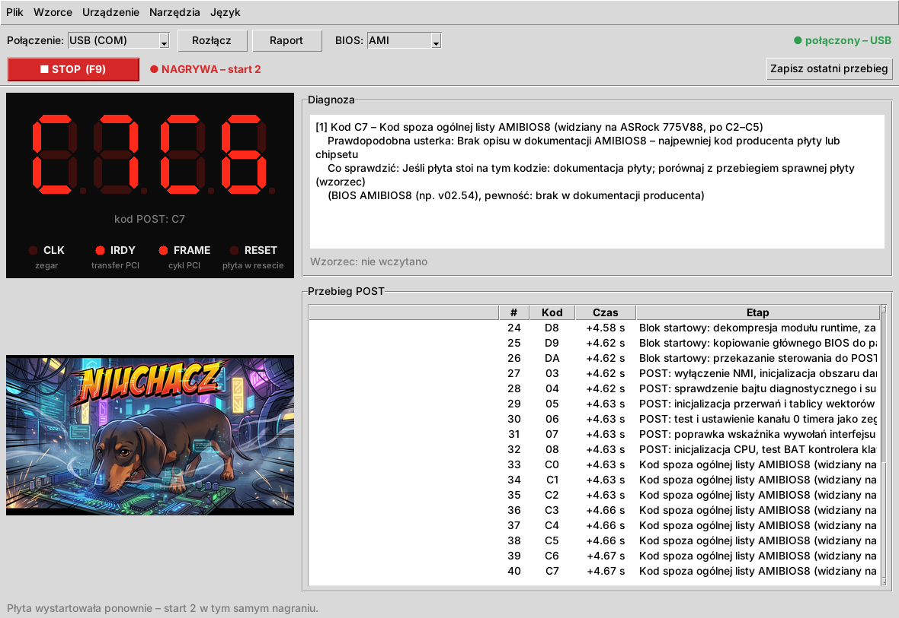
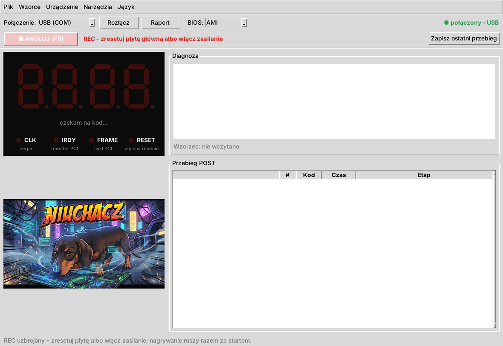
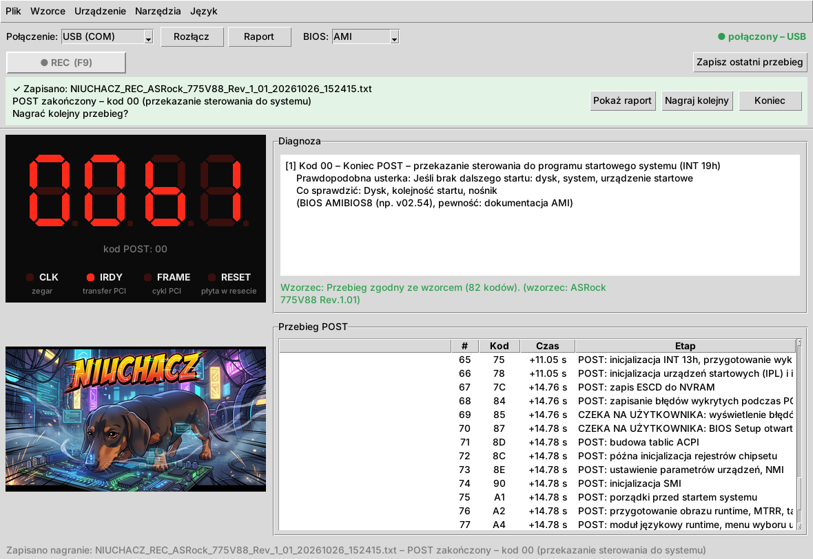
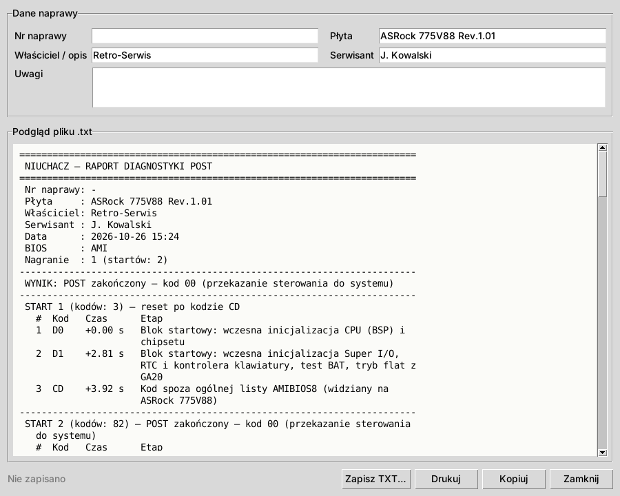
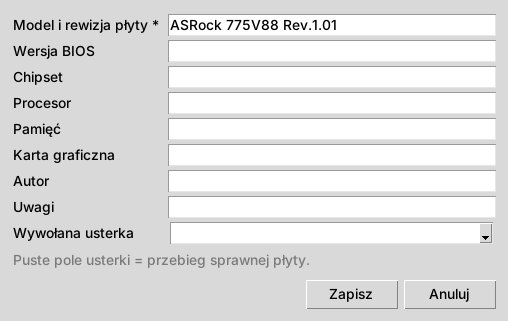
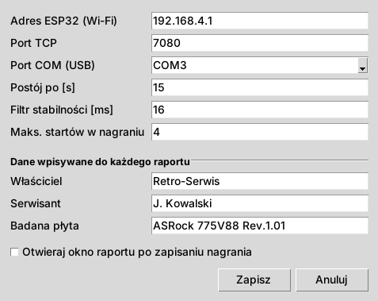

# NIUCHACZ – instrukcja obsługi

[English version](MANUAL.md) · [Karty POST – zgodność](CARDS.md#polski) · [README](../README.md#polski)

NIUCHACZ zapisuje kody POST z karty diagnostycznej podczas startu płyty głównej i tłumaczy je
na zrozumiały język. Ta instrukcja opisuje **obsługę** gotowego urządzenia z kartą **typu A**
(z zatrzaskiem 74LCX374). Budowa urządzenia ma osobną instrukcję (w przygotowaniu).

## Spis treści

1. [Czego potrzebujesz](#1-czego-potrzebujesz)
2. [Pierwsze uruchomienie](#2-pierwsze-uruchomienie)
3. [Okno główne](#3-okno-główne)
4. [Diagnoza płyty krok po kroku (REC)](#4-diagnoza-płyty-krok-po-kroku-rec)
5. [Raport](#5-raport)
6. [Wzorce – porównanie ze sprawną płytą](#6-wzorce--porównanie-ze-sprawną-płytą)
7. [Ustawienia](#7-ustawienia)
8. [Pozostałe funkcje](#8-pozostałe-funkcje)
9. [Gdy coś nie działa](#9-gdy-coś-nie-działa)
10. [Ograniczenia](#10-ograniczenia)

---

## 1. Czego potrzebujesz

- **Karta POST typu A** z podłączonym kablem DB25 (patrz [tabela kart](CARDS.md#polski)).
- **Pudełko NIUCHACZ** (ESP32) z wgranym firmware.
- **Komputer z programem NIUCHACZ**: Windows albo Linux, Python 3.10+ (instalacja w [README](../README.md#szybki-start)).
- Połączenie z pudełkiem **przez Wi-Fi** (sieć `NIUCHACZ`) albo **kablem USB**.

> ⚠ Nigdy nic nie podłączaj do diod −12 V / +12 V na karcie POST.

## 2. Pierwsze uruchomienie

1. Włóż kartę POST do slotu PCI badanej płyty, podłącz kabel DB25 do pudełka.
2. Zasil pudełko (USB z komputera albo ładowarki). Po ok. 3 s firmware startuje.
3. Wybierz połączenie:
   - **Wi-Fi:** połącz komputer z siecią **NIUCHACZ** (hasło ustawione w `config.py` na ESP32),
     w programie wybierz **Wi-Fi (TCP)**.
   - **USB:** wybierz **USB (COM)**; port ustawisz w **Narzędzia → Ustawienia… → Port COM (USB)**
     (Windows: `COM3`…, Linux: `/dev/ttyUSB0`).
4. Kliknij **Połącz**. W prawym górnym rogu pojawi się zielone **połączony**.
5. Ustaw producenta BIOS-u na pasku (**BIOS:** AMI / Award / Phoenix) – od tego zależą opisy kodów.
   Producenta poznasz po ekranie startowym płyty („American Megatrends” = AMI, „Award” = Award).
6. Wpisz raz swoje dane do raportów: **Narzędzia → Ustawienia…**, sekcja *Dane wpisywane do każdego raportu*.

Program uruchamia się w języku systemu; zmienisz go w menu **Język**.

## 3. Okno główne

| Element | Co pokazuje |
|---|---|
| **Połączenie / Połącz / Raport / BIOS** | wybór Wi-Fi albo USB, przycisk raportu bieżącej sesji, producent BIOS-u |
| **REC (F9)** | nagrywanie przebiegu – patrz [rozdział 4](#4-diagnoza-płyty-krok-po-kroku-rec) |
| **Zapisz ostatni przebieg** | zapisuje przebieg, przy którym REC nie był wciśnięty |
| **Wyświetlacz** | ostatni kod POST (lewa para) i poprzedni (prawa para), opis pod spodem |
| **CLK · IRDY · FRAME · RESET** | diody karty: IRDY/FRAME świecą przy ruchu na magistrali PCI, RESET – płyta w resecie. CLK (zegar 33 MHz) jest za szybki dla ESP32 i nie jest odczytywany |
| **Diagnoza** | opis bieżącego kodu: etap POST, prawdopodobna usterka, co sprawdzić, pewność opisu |
| **Wzorzec** | wynik porównania ze wzorcem sprawnej płyty ([rozdział 6](#6-wzorce--porównanie-ze-sprawną-płytą)) |
| **Przebieg POST** | wszystkie kody, pogrupowane w sesje (każdy start płyty = sesja), z czasem od początku sesji |
| **Pasek stanu** (na dole) | komunikaty programu |

Podgląd na żywo działa zawsze. **Bez REC nic się nie zapisuje i żadne okno samo nie wyskakuje.**

## 4. Diagnoza płyty krok po kroku (REC)

1. Połącz się z pudełkiem i ustaw producenta BIOS-u.
2. Wciśnij **REC** albo **F9**. Przycisk zmienia się na migające **ANULUJ**, obok komunikat
   *„REC – zresetuj płytę główną albo włącz zasilanie”*.

   

3. **Zresetuj płytę** (przycisk RESET) **albo włącz zasilanie.** Nagrywanie rusza razem ze startem płyty;
   na przycisku pojawia się **STOP**, obok **● NAGRYWA – start 1**.
4. Czekaj. Nagranie kończy się samo:

   | Koniec | Kiedy |
   |---|---|
   | **POST zakończony** | kod `00` lub `FF` i 3 s ciszy (po co najmniej 10 kodach) |
   | **Czeka na użytkownika** | BIOS czeka na klawisz (np. `85`, `87` – błąd z F1, BIOS Setup) dłużej niż 5 s |
   | **Postój** | kod nie zmienia się przez 15 s (*Postój po [s]* w ustawieniach) – typowe zawieszenie |
   | **Pętla restartów** | płyta zrestartowała się 4 razy bez dojścia do końca POST |
   | **Zatrzymane ręcznie** | wciśnięty **STOP** / F9 |

5. Program **sam zapisuje** raport TXT i plik CSV w folderze `reports/` i pyta:

   

   - **Pokaż raport** – otwiera raport ([rozdział 5](#5-raport)),
   - **Nagraj kolejny** – od razu uzbraja REC dla następnej próby,
   - **Koniec** – chowa pasek.

**Kilka startów w jednym nagraniu.** Reset w trakcie nagrania nie kończy go – otwiera kolejny *start*.
Wiele płyt resetuje się przy uruchomieniu raz celowo (np. ASRock 775V88 po kodzie `CD`, po ustawieniu
procesora), więc pełny przebieg sprawnej płyty to często **2 starty**. Raport pokazuje każdy start osobno
i ostatni kod przed każdym resetem. Gdy płyta wpada w **pętlę restartów**, ta lista od razu pokazuje,
na którym kodzie pada.

## 5. Raport

Okno raportu otwiera **Pokaż raport** po nagraniu, przycisk **Raport** / **Ctrl+R** (bieżąca sesja)
albo – jeśli tak ustawisz – samo po każdym nagraniu.

- **Dane naprawy:** nr naprawy, płyta, właściciel, serwisant, uwagi. Płyta, właściciel i serwisant
  wypełniają się z ustawień; zmiany w tym oknie dotyczą tylko tego raportu.
- **Zapisz TXT… / Drukuj / Kopiuj** – raport ma szerokość 72 znaków i mieści się na kartce A4.

**Co jest w raporcie:** wynik nagrania, każdy start z listą kodów (czas od początku, opis etapu),
ostatni kod każdego startu, pełna diagnoza ostatniego kodu, porównanie ze wzorcem i uwagi.

**Oznaczenia przy kodach:**

| Znak | Znaczenie |
|---|---|
| `!` | kod zmienił się, gdy ESP32 nie czytał karty (krótka przerwa w odczycie) – kody tuż przed nim **mogły** zginąć |
| `~` | bardzo krótki kod (ok. 1 µs), złapany jednym odczytem – najpewniej prawdziwy, ale mniej pewny |
| `*` | (tylko karty z odczytem wyświetlacza) kod mignął za szybko, odczytany z historii karty |

Linia **„Odczyt ESP32: najdłuższa przerwa … ms, kodów złapanych po przerwie: …”** mówi, jak kompletny
jest zapis. Na sprawnym zestawie przerwy mają kilkanaście–kilkadziesiąt ms, a `!` pojawia się rzadko.

**Pliki:** `reports/NIUCHACZ_REC_<naprawa>_<płyta>_<data>_<godzina>.txt` i `.csv` (te same kody
z numerem startu i czasem w ms – do Excela / LibreOffice).

## 6. Wzorce – porównanie ze sprawną płytą

Wzorzec to zapisany przebieg **sprawnej** płyty. Przy naprawie takiej samej płyty program pokazuje,
w którym miejscu start odbiega od wzorca – czyli między którymi etapami jest usterka.

**Nagranie wzorca:** po nagraniu sprawnej płyty wybierz **Wzorce → Nagraj wzorzec z bieżącej sesji…**,
wpisz model i rewizję płyty (wymagane), resztę według uznania, **Zapisz**. Pliki trafiają do `data/golden_runs/`.

Pole **Wywołana usterka** pozwala nagrać też wzorce *celowo zepsutej* płyty (bez RAM, bez karty graficznej,
wyczyszczony CMOS…). Wtedy wiesz, jak wygląda dany objaw na tej płycie.

> Najlepszy wzorzec to drugi start płyty (po jej zaplanowanym resecie) z przebiegu, w którym
> złapały się też krótkie kody `~`.

**Porównanie:** **Wzorce → Porównuj ze wzorcem…** i wybierz plik. Wynik widać pod diagnozą i w raporcie:

| Komunikat | Znaczenie |
|---|---|
| *Przebieg zgodny ze wzorcem* (zielony) | start przebiegł jak na sprawnej płycie |
| *…tym razem nie złapały się bardzo krótkie kody: …* | zgodny – brakuje tylko kodów `~`, to normalne |
| *…poza brakującymi kodami: …* | zgodny – brak pojedynczych kodów, a dalej wszystko się zgadza: najpewniej strata odczytu |
| *Start zatrzymał się po N zgodnych kodach…* (pomarańczowy) | płyta stanęła wcześniej niż wzorzec – usterka między ostatnim zgodnym a następnym etapem |
| *Rozbieżność na pozycji…* (pomarańczowy) | płyta poszła inną drogą niż sprawna |

## 7. Ustawienia

**Narzędzia → Ustawienia…**

| Pole | Znaczenie |
|---|---|
| Adres ESP32 (Wi-Fi), Port TCP | domyślnie `192.168.4.1`, `7080` – zmieniaj tylko po zmianie w firmware |
| Port COM (USB) | port pudełka podłączonego kablem |
| Postój po [s] | po ilu sekundach bez zmiany kodu uznać postój (domyślnie 15) |
| Filtr stabilności [ms] | tylko dla kart z odczytem wyświetlacza |
| Maks. startów w nagraniu | po ilu startach nagranie kończy się jako *pętla restartów* (domyślnie 4) |
| Właściciel, Serwisant, Badana płyta | wpisywane do każdego raportu |
| Otwieraj okno raportu po zapisaniu nagrania | domyślnie wyłączone – nagranie i tak zapisuje się samo |

Czasy *POST zakończony* (3 s) i *czeka na użytkownika* (5 s) można zmienić w pliku `config/settings.json`
(`rec_done_seconds`, `rec_wait_seconds`).

## 8. Pozostałe funkcje

- **Plik → Zakończ sesję i pokaż raport** (**Ctrl+R**, przycisk **Raport**) – raport bieżącej sesji bez REC.
- **Plik → Zapisz ostatni przebieg** – nagranie po fakcie, gdy REC nie był wciśnięty.
- **Plik → Eksportuj sekwencję CSV…** – kody bieżącej sesji do CSV.
- **Narzędzia → Przeładuj bazę kodów** – po edycji opisów w `data/post_codes/*.json`
  (każdy wpis: kod, etap, usterka, co sprawdzić – po polsku i angielsku, źródło, pewność).
  Najpełniejsza jest baza **AMI** (AMIBIOS8); **Award** ma kilka wpisów, **Phoenix** jest pusty – dopiszesz własne.
- **Narzędzia → Kalibracja wyświetlacza (stara metoda)…** – tylko dla kart, z których czytamy wyświetlacz (typ B).
- **Urządzenie → Ping** – sprawdza, czy ESP32 odpowiada.
- **Urządzenie → Lista / Pobierz / Usuń sesje z ESP32** – sesje zapisane w pamięci pudełka. Zapis na ESP32
  jest **domyślnie wyłączony**, bo zapis do pamięci flash przerywa odczyt karty i kody giną.
  Włączysz go w `config.py` na ESP32: `STORE_SESSIONS = True`.
- **Język** – polski / angielski; raporty powstają w bieżącym języku.

## 9. Gdy coś nie działa

| Objaw | Co zrobić |
|---|---|
| *„Brak jakichkolwiek danych z urządzenia od 5 s”* | zrestartuj ESP32 przyciskiem **EN**; przy USB sprawdź, czy port nie jest zajęty (np. przez Thonny – **Uruchom → Rozłącz**) |
| Nie można otworzyć portu USB | zamknij inne programy na tym porcie; Linux: użytkownik w grupie `uucp` (Arch) / `dialout` (Debian, Ubuntu) |
| Na ESP32 komunikat *„stare pliki na ESP32 – wgraj z repozytorium: …”* | wgraj wymienione pliki z folderu `firmware/` (README → Firmware) |
| Wyświetlacz pokazuje tylko `00` | odpięty kabel DB25 albo płyta jeszcze nie ruszyła; `00` zaraz po włączeniu zasilania to normalne |
| Kody nie zgadzają się z kartą | porównaj z lewą parą cyfr karty; zamienione bity = kolejność przewodów (`LATCH_ORDER` w `config.py`) |
| Dioda RESET świeci cały czas | w `config.py` na ESP32 zła polaryzacja: `RST_ACTIVE_HIGH` |
| Dużo `!` w raporcie, przerwy setki ms | stary firmware – wgraj aktualne pliki z `firmware/` |
| Opis „brak w bazie” | kod nieopisany w dokumentacji – zapisz przebieg, a po ustaleniu przyczyny dopisz wpis do bazy |

## 10. Ograniczenia

- **Zegar PCI (CLK)** – 33 MHz, ESP32 go nie odczyta.
- **Kody krótsze niż ok. 0,7 µs** mogą nie zostać złapane (odstęp między odczytami ESP32). Na płycie ASRock
  775V88 dotyczy to rzadko kodu `C1`. Pełną pewność da licznik zapisów (planowany: pin 11 zatrzasku).
- **Opisy kodów** pochodzą z dokumentacji producentów BIOS-u; kody producentów płyt (np. `C0`–`C7`, `61`–`70`
  w AMI) są opisane ogólnie albo jako zaobserwowane na konkretnej płycie.
- **Karty bez zatrzasku** (typ B) – kody tylko z wyświetlacza, szybkie kody giną; patrz [tabela kart](CARDS.md#polski).
