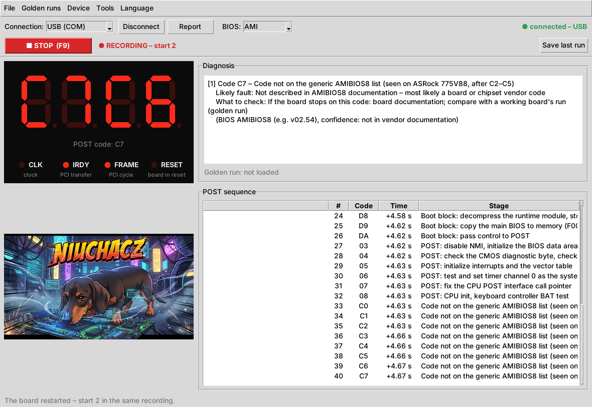
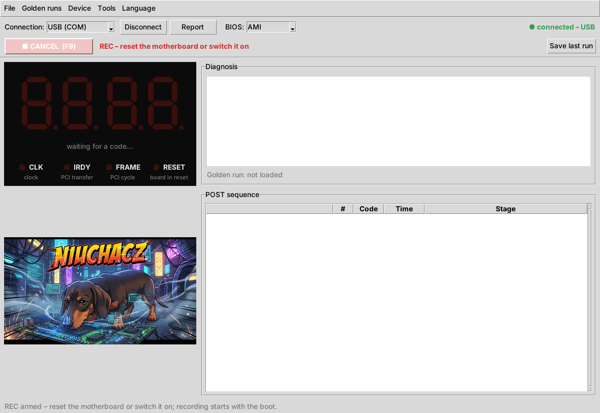
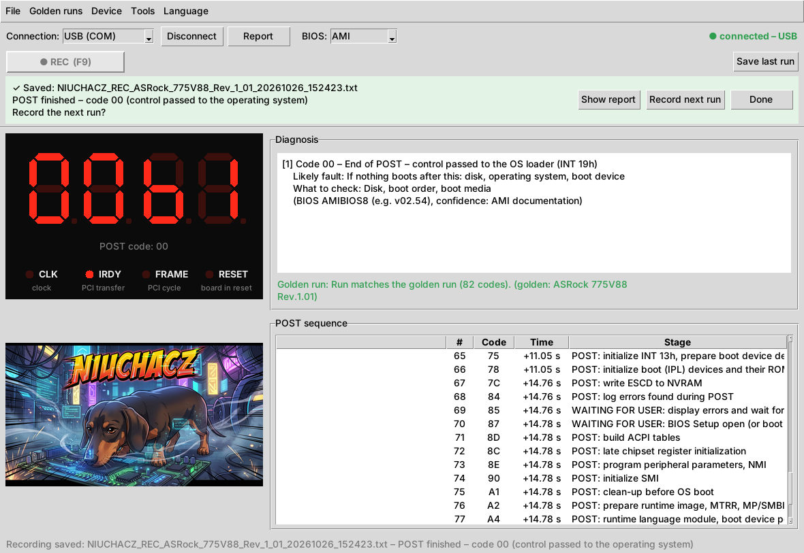
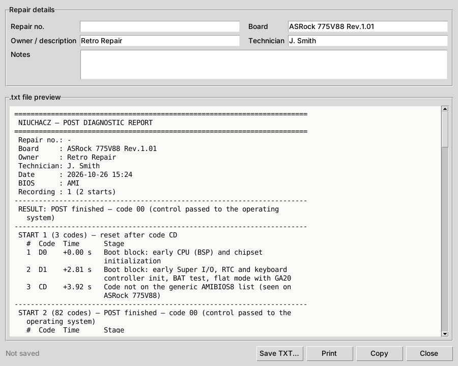
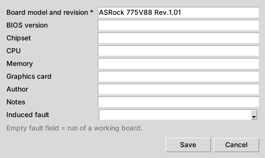
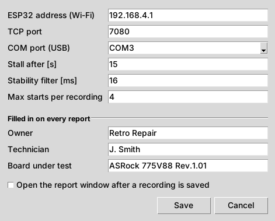

# NIUCHACZ – user manual

[Wersja polska](INSTRUKCJA.md) · [POST cards – compatibility](CARDS.md#english) · [README](../README.md#english)

NIUCHACZ records POST codes from a diagnostic card while a motherboard boots and explains them
in plain language. This manual covers **using** a finished unit with a **type A** card
(with the 74LCX374 latch). Building the unit has its own guide (in preparation).

## Contents

1. [What you need](#1-what-you-need)
2. [First start](#2-first-start)
3. [Main window](#3-main-window)
4. [Diagnosing a board step by step (REC)](#4-diagnosing-a-board-step-by-step-rec)
5. [Report](#5-report)
6. [Golden runs – comparing with a healthy board](#6-golden-runs--comparing-with-a-healthy-board)
7. [Settings](#7-settings)
8. [Other functions](#8-other-functions)
9. [Troubleshooting](#9-troubleshooting)
10. [Limitations](#10-limitations)

---

## 1. What you need

- **A type A POST card** with the DB25 cable fitted (see the [card table](CARDS.md#english)).
- **The NIUCHACZ box** (ESP32) with the firmware installed.
- **A computer with the NIUCHACZ app**: Windows or Linux, Python 3.10+ (installation in the [README](../README.md#quick-start)).
- A link to the box **over Wi-Fi** (network `NIUCHACZ`) or **a USB cable**.

> ⚠ Never connect anything to the −12 V / +12 V LEDs on the POST card.

## 2. First start

1. Put the POST card into a PCI slot of the board under test and connect the DB25 cable to the box.
2. Power the box (USB from the computer or a charger). The firmware starts after about 3 s.
3. Choose the link:
   - **Wi-Fi:** join the **NIUCHACZ** network (password set in `config.py` on the ESP32) and select **Wi-Fi (TCP)**.
   - **USB:** select **USB (COM)**; set the port in **Tools → Settings… → COM port (USB)**
     (Windows: `COM3`…, Linux: `/dev/ttyUSB0`).
4. Click **Connect**. A green **connected** appears in the top right corner.
5. Set the BIOS vendor on the toolbar (**BIOS:** AMI / Award / Phoenix) – the code descriptions depend on it.
   The boot screen tells you: "American Megatrends" = AMI, "Award" = Award.
6. Enter your report details once: **Tools → Settings…**, section *Filled in on every report*.

The app starts in the system language; change it in the **Language** menu.

## 3. Main window

| Element | Shows |
|---|---|
| **Connection / Connect / Report / BIOS** | Wi-Fi or USB, report of the current session, BIOS vendor |
| **REC (F9)** | recording a run – see [chapter 4](#4-diagnosing-a-board-step-by-step-rec) |
| **Save last run** | saves a run you did not arm REC for |
| **Display** | last POST code (left pair) and the previous one (right pair), description below |
| **CLK · IRDY · FRAME · RESET** | card LEDs: IRDY/FRAME light up with PCI bus activity, RESET = board held in reset. CLK (33 MHz) is too fast for the ESP32 and is not read |
| **Diagnosis** | current code: POST stage, likely fault, what to check, confidence of the description |
| **Golden run** | result of the comparison with a healthy board ([chapter 6](#6-golden-runs--comparing-with-a-healthy-board)) |
| **POST sequence** | all codes grouped into sessions (each board boot = one session) with time from the session start |
| **Status bar** (bottom) | app messages |

The live view always runs. **Without REC nothing is saved and no window pops up by itself.**

## 4. Diagnosing a board step by step (REC)

1. Connect to the box and set the BIOS vendor.
2. Press **REC** or **F9**. The button turns into a blinking **CANCEL** with the message
   *"REC – reset the motherboard or switch it on"*.

   

3. **Reset the board** (RESET button) **or switch it on.** Recording starts with the boot;
   the button shows **STOP** and **● RECORDING – start 1**.
4. Wait. The recording ends by itself:

   | End | When |
   |---|---|
   | **POST finished** | code `00` or `FF` and 3 s of quiet (after at least 10 codes) |
   | **Waiting for user** | the BIOS waits for a key (e.g. `85`, `87` – F1 error, BIOS Setup) for more than 5 s |
   | **Stalled** | the code does not change for 15 s (*Stall after [s]* in settings) – a typical hang |
   | **Restart loop** | the board restarted 4 times without finishing POST |
   | **Stopped manually** | **STOP** / F9 pressed |

5. The app **saves** a TXT report and a CSV file in `reports/` and asks:

   

   - **Show report** – opens the report ([chapter 5](#5-report)),
   - **Record next run** – arms REC again for the next attempt,
   - **Done** – hides the bar.

**Several starts in one recording.** A reset during a recording does not end it – it opens the next *start*.
Many boards reset once on purpose when powered on (e.g. ASRock 775V88 after code `CD`, once the CPU is set up),
so a full run of a healthy board is often **2 starts**. The report shows each start separately and the last
code before each reset. If the board is in a **restart loop**, that list shows where it fails.

## 5. Report

The report window opens from **Show report** after a recording, from the **Report** button / **Ctrl+R**
(current session) or – if enabled – by itself after each recording.

- **Repair details:** repair no., board, owner, technician, notes. Board, owner and technician come from
  the settings; changes here apply to this report only.
- **Save TXT… / Print / Copy** – the report is 72 characters wide and fits an A4 page.

**Contents:** result, each start with its codes (time from the start, stage description), the last code of
each start, full diagnosis of the last code, golden-run comparison and notes.

**Marks next to codes:**

| Mark | Meaning |
|---|---|
| `!` | the code changed while the ESP32 was not reading (a short reading gap) – codes just before it **may** be missing |
| `~` | very short code (about 1 µs) caught by a single read – most likely real, but less certain |
| `*` | (display-reading cards only) the code flashed too fast and was recovered from the card's history |

The line **"ESP32 reading: longest gap … ms, codes caught after a gap: …"** tells how complete the record is.
On a working setup gaps are tens of milliseconds and `!` is rare.

**Files:** `reports/NIUCHACZ_REC_<repair>_<board>_<date>_<time>.txt` and `.csv` (the same codes with the start
number and time in ms – for Excel / LibreOffice).

## 6. Golden runs – comparing with a healthy board

A golden run is the saved run of a **healthy** board. When repairing the same model, the app shows where the
boot departs from it – i.e. between which stages the fault is.

**Recording a golden run:** after recording a healthy board choose **Golden runs → Record golden run from
current session…**, enter the board model and revision (required) and anything else you know, **Save**.
Files go to `data/golden_runs/`.

**Induced fault** lets you record runs of a board broken *on purpose* (no RAM, no graphics card, CMOS cleared…),
so you know what a given symptom looks like on that board.

> The best golden run is the second start of the board (after its planned reset) from a run in which the
> short `~` codes were caught as well.

**Comparing:** **Golden runs → Compare with golden run…** and choose a file. The result appears below the diagnosis
and in the report:

| Message | Meaning |
|---|---|
| *Run matches the golden run* (green) | the boot went exactly like on the healthy board |
| *…very short codes not caught this time: …* | matches – only `~` codes are missing, which is normal |
| *…except for missing codes: …* | matches – single codes missing, the rest is identical: most likely a reading loss |
| *Boot stopped after N matching codes…* (orange) | the board stopped earlier than the reference – fault between the last matching and the next stage |
| *Divergence at position…* (orange) | the board took a different path than the healthy one |

## 7. Settings

**Tools → Settings…**

| Field | Meaning |
|---|---|
| ESP32 address (Wi-Fi), TCP port | default `192.168.4.1`, `7080` – change only after changing the firmware |
| COM port (USB) | port of the box connected by cable |
| Stall after [s] | seconds without a code change before it counts as a stall (default 15) |
| Stability filter [ms] | display-reading cards only |
| Max starts per recording | after how many starts a recording ends as a *restart loop* (default 4) |
| Owner, Technician, Board under test | put into every report |
| Open the report window after a recording is saved | off by default – recordings are saved anyway |

The *POST finished* (3 s) and *waiting for user* (5 s) times can be changed in `config/settings.json`
(`rec_done_seconds`, `rec_wait_seconds`).

## 8. Other functions

- **File → End session and show report** (**Ctrl+R**, **Report** button) – report of the current session without REC.
- **File → Save last run** – a recording after the fact when REC was not armed.
- **File → Export sequence to CSV…** – codes of the current session to CSV.
- **Tools → Reload code database** – after editing `data/post_codes/*.json`
  (each entry: code, stage, fault, what to check – in English and Polish, source, confidence).
  **AMI** (AMIBIOS8) is the most complete; **Award** has a few entries and **Phoenix** is empty – add your own.
- **Tools → Display calibration (legacy)…** – only for cards read from the display (type B).
- **Device → Ping** – checks that the ESP32 answers.
- **Device → List / Download / Delete sessions on ESP32** – sessions stored in the box. Storing on the ESP32 is
  **off by default**, because flash writes interrupt reading the card and codes get lost.
  Enable it in `config.py` on the ESP32: `STORE_SESSIONS = True`.
- **Language** – English / Polish; reports are written in the current language.

## 9. Troubleshooting

| Symptom | What to do |
|---|---|
| *"No data from the device for 5 s"* | restart the ESP32 with **EN**; on USB check that no other program holds the port (e.g. Thonny – **Run → Disconnect**) |
| USB port cannot be opened | close other programs using it; Linux: user in group `uucp` (Arch) / `dialout` (Debian, Ubuntu) |
| ESP32 prints *"stare pliki na ESP32 – wgraj z repozytorium: …"* (stale files – upload from the repository) | upload the listed files from `firmware/` (README → Firmware) |
| Display shows only `00` | DB25 cable unplugged or the board has not started yet; `00` right after power-on is normal |
| Codes differ from the card | compare with the card's left digit pair; swapped bits = wire order (`LATCH_ORDER` in `config.py`) |
| RESET LED always lit | wrong polarity in `config.py` on the ESP32: `RST_ACTIVE_HIGH` |
| Many `!`, gaps of hundreds of ms | old firmware – upload the current `firmware/` files |
| "not in the database" | the code is not documented – save the run and add an entry once you know the cause |

## 10. Limitations

- **PCI clock (CLK)** – 33 MHz, the ESP32 cannot read it.
- **Codes shorter than about 0.7 µs** may be missed (time between ESP32 reads). On the ASRock 775V88 this rarely
  affects code `C1`. Full certainty needs a write counter (planned: latch pin 11).
- **Code descriptions** come from BIOS vendor documentation; board-vendor codes (e.g. `C0`–`C7`, `61`–`70` in AMI)
  are described in general terms or as observed on a specific board.
- **Cards without a latch** (type B) – codes from the display only, fast codes are lost; see the [card table](CARDS.md#english).
