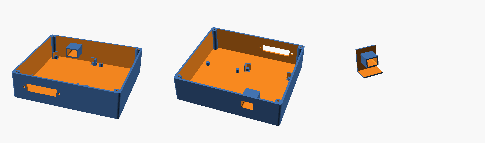

# NIUCHACZ – 3D printed box / obudowa do druku 3D

[English](#english) · [Polski](#polski)

| File | |
|---|---|
| `niuchacz_box.scad` | parametric source (OpenSCAD) / źródło parametryczne |
| `niuchacz_box_base.stl` | base / dno |
| `niuchacz_box_lid.stl` | lid (already flipped for printing) / wieczko (już obrócone do druku) |
| `niuchacz_box_test.stl` | small test piece with the USB-C tunnel / mały wydruk testowy z tunelem USB-C |

Outer size / wymiary zewnętrzne: **137.8 × 121.8 × 38 mm** (version v3, 17.10.2026).

---

## English

**Inside:** ESP32 on an ARK screw-terminal adapter (63 × 77 mm) and the level-converter board
with CD4050 (50 × 70 mm). DB25 to the POST card in the back wall, power and data through the ESP32's own
USB-C socket via a tunnel in the front wall. Holes in the lid for the EN and BOOT buttons (press with a
toothpick), a recess for a 30 × 30 mm Wi-Fi antenna, vents, "NIUCHACZ" lettering.

**Printing** (settings used for Anycubic Kobra 3 V2): PLA, 0.2 mm layers, 3 perimeters, 20 % infill, no supports.
Base bottom down, lid lettering down (the STL is already flipped).
Print `niuchacz_box_test.stl` first – it checks that the USB-C plug reaches the ESP32 socket.

**Assembly:** M3 self-tapping screws in the corner posts for the lid, M2 self-tapping screws for the
converter board. Hot glue only after everything works.

**Your own boards:** all measurements are in the `PARAMETERS` section of the `.scad` file – board sizes,
USB-C position (`usb_x_from_esp_left`, `usb_z_above_esp_bottom`), button holes (`btn_pos`), connector type
(`dsub1`) and a second connector (`dsub2`, e.g. `"DE9"`). Render one part with `part = "base"` / `"lid"` /
`"test"`, export STL (F6, then F7). **Check the USB-C and button positions on your own ESP32 board** –
they differ between board makers.

---

## Polski

**W środku:** ESP32 na adapterze ARK z zaciskami (63 × 77 mm) i płytka konwerterów poziomów z CD4050
(50 × 70 mm). DB25 do karty POST w tylnej ściance, zasilanie i dane przez gniazdo USB-C samego ESP32,
tunelem w przedniej ściance. W wieczku otwory na przyciski EN i BOOT (wykałaczką), wgłębienie na antenę
Wi-Fi 30 × 30 mm, wentylacja i napis „NIUCHACZ”.

**Druk** (ustawienia dla Anycubic Kobra 3 V2): PLA, warstwa 0,2 mm, 3 obrysy, 20 % wypełnienia, bez podpór.
Dno dnem do stołu, wieczko napisem do stołu (STL jest już obrócony).
Najpierw wydrukuj `niuchacz_box_test.stl` – sprawdzisz, czy wtyczka USB-C sięga gniazda ESP32.

**Montaż:** wieczko na wkręty samogwintujące M3 w słupkach w rogach, płytka konwerterów na wkręty M2.
Klej na gorąco dopiero po sprawdzeniu, że wszystko działa.

**Własne płytki:** wszystkie wymiary są w sekcji `PARAMETRY` pliku `.scad` – rozmiary płytek, położenie USB-C
(`usb_x_from_esp_left`, `usb_z_above_esp_bottom`), otwory na przyciski (`btn_pos`), typ złącza (`dsub1`)
i drugie złącze (`dsub2`, np. `"DE9"`). Jedną część wybierasz przez `part = "base"` / `"lid"` / `"test"`,
eksport STL: F6, potem F7. **Sprawdź położenie USB-C i przycisków na swojej płytce ESP32** – różni się
u różnych producentów.
